# 软件设计师 · 全真模拟考试系统（软考中级）

> 一个可以离线运行的软考中级「软件设计师」模拟考场：**Web 端 + Android App 双端**，内置 **2155 道**自建题库，
> 支持上午卷 / 下午卷 / 综合训练卷 / 历年真题整卷模考、服务端权威倒计时、答题卡、未答拦截、自动评分与历史成绩。
> 全部数据保存在本地 SQLite，无需注册账号、不联网、不上传任何作答内容。

<p align="center">
  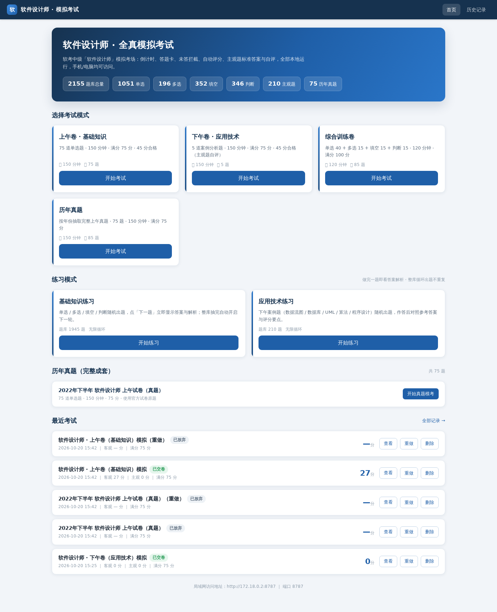
</p>

<p align="center">
  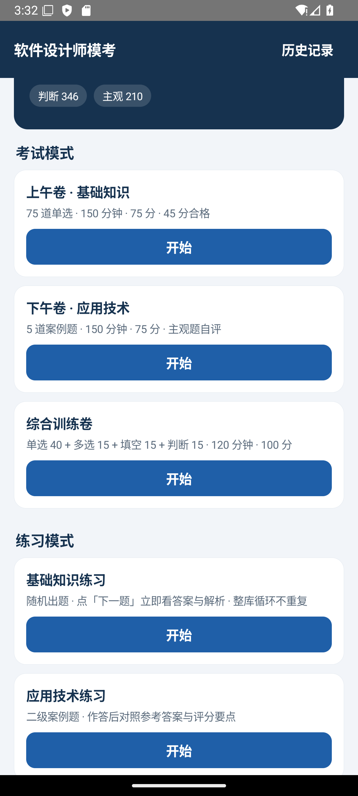
  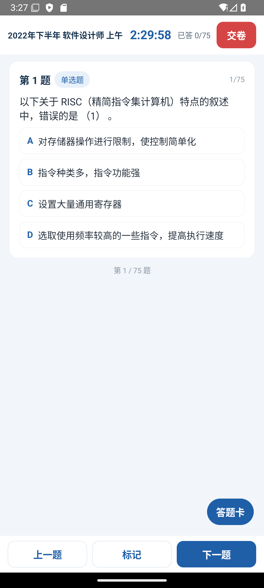
  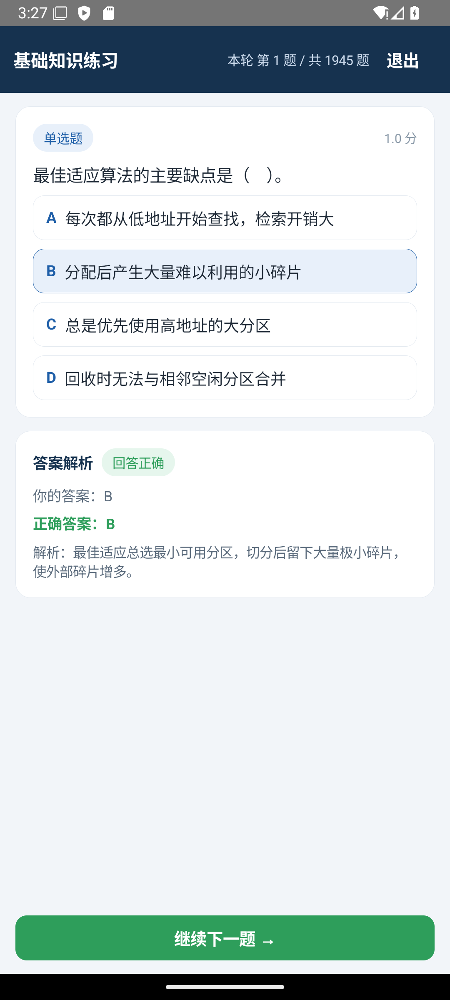
</p>

**English** — A self-hosted mock exam system for China's "Software Designer" (mid-level) certification, with an offline Android app. It ships a 2,155-question bank (single / multiple choice, fill-in-the-blank, true-false, subjective case questions), implements a real exam flow (authoritative countdown, answer sheet, submit blocking, auto-grading, history), and stores everything in a single local SQLite file. Node.js ≥ 22.5 for the web server; no runtime dependencies.

---

## 目录

- [功能特性](#功能特性)
- [界面截图](#界面截图)
- [题库内容](#题库内容)
- [技术架构](#技术架构)
- [快速开始](#快速开始)
- [Android App](#android-app)
- [项目结构](#项目结构)
- [HTTP API](#http-api)
- [数据库结构](#数据库结构)
- [测试](#测试)
- [参与贡献](#参与贡献)
- [常见问题](#常见问题)
- [免责声明](#免责声明)
- [许可证](#许可证)

---

## 功能特性

| 模块 | 说明 |
| --- | --- |
| 四种考试模式 | 上午卷（75 单选 / 150 分钟 / 75 分）、下午卷（5 道案例题 / 150 分钟 / 75 分）、综合训练卷（40 单选 + 15 多选 + 15 填空 + 15 判断 / 120 分钟 / 100 分）、历年真题整卷模考 |
| 随机组卷 | 按真题考点权重分层抽题（易:中:难 ≈ 3.5:4.5:2），同一试卷内不重复，并修复「连续 3 题同模块」 |
| 服务端权威计时 | 交卷时间由服务端 `deadline_at` 判定，到点强制交卷，刷新/关页面不重置；剩余 5 分钟红色闪烁提醒 |
| 答题卡 | 已答 / 未答 / 当前题 / 标记题四态可视，点击任意题号跳转 |
| 未答拦截 | 存在未答题时拒绝交卷，列出未答题号，交卷前二次确认 |
| 自动评分 | 单选 / 判断按答案比对；多选全对得分；填空按空给分，支持同义写法（`|` 分隔）、忽略大小写与全角空格 |
| 主观题自评 | 交卷后展示参考答案与评分要点，按题自评 0–15 分，计入总分与历史 |
| 断点续考 | 作答实时落库，进程重启或换设备（同一服务）后可继续上次考试 |
| 重做试卷 | 成绩页与历史记录可一键按原题、原顺序重新开考 |
| 历史成绩 | 客观分 / 主观分 / 总分 / 用时 / 是否超时交卷，可逐题回看解析、可删除 |
| 响应式 Web | 桌面右侧答题卡常驻，手机端底部抽屉 + 悬浮答题卡按钮，同一 Wi-Fi 下手机浏览器直接作答 |
| 完全离线 App | Android 端内置题库资产，无网络权限，不出网 |

---

## 界面截图

### Web 端

<p align="center">
  <br />
  <sub>首页：题库规模、四种考试模式、练习模式、历年真题入口、最近考试</sub>
</p>

<p align="center">
  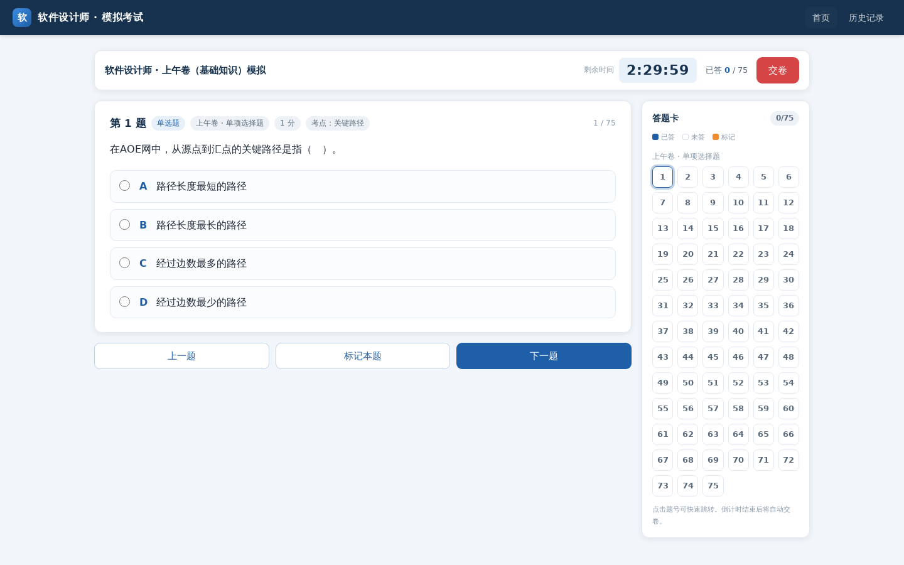<br />
  <sub>考试页：倒计时、答题卡、题号四态与上一题 / 下一题</sub>
</p>

<p align="center">
  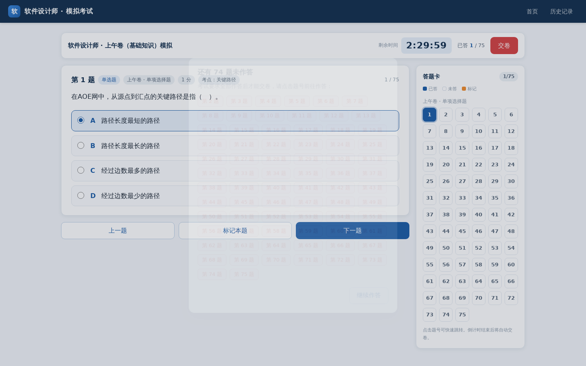
  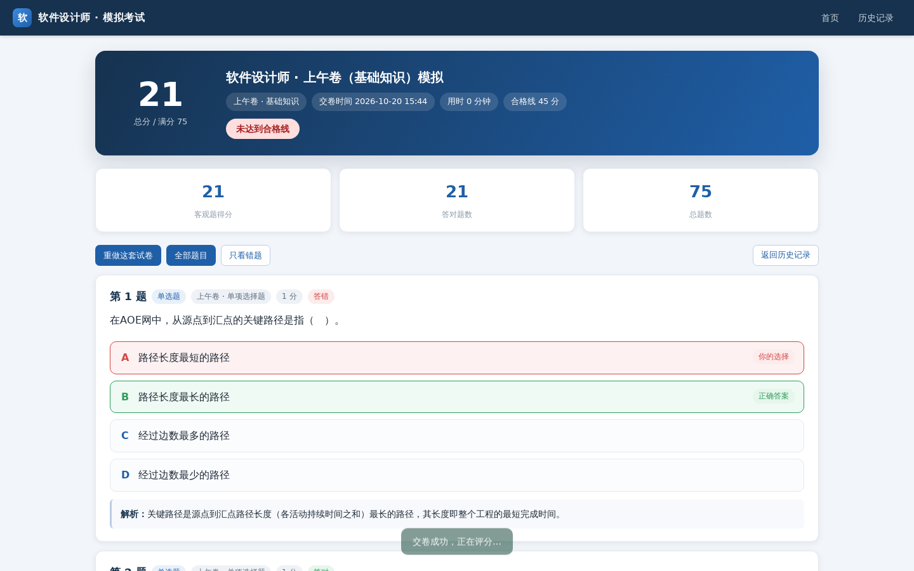<br />
  <sub>左：未答拦截弹窗（列出未答题号）　右：成绩页与逐题解析</sub>
</p>

<p align="center">
  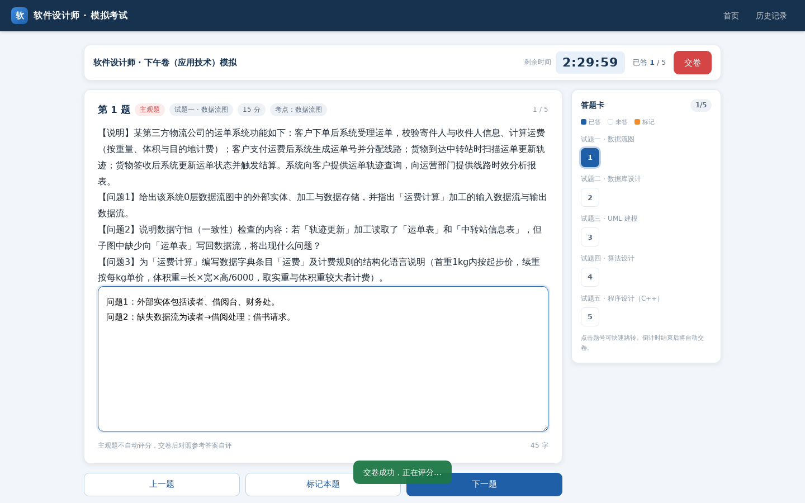
  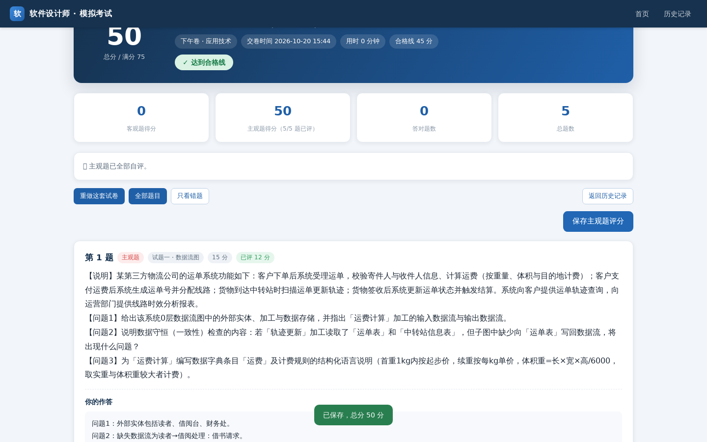<br />
  <sub>左：下午卷案例题作答　右：交卷后对照答案自评</sub>
</p>

### Android App

<p align="center">
  
  
  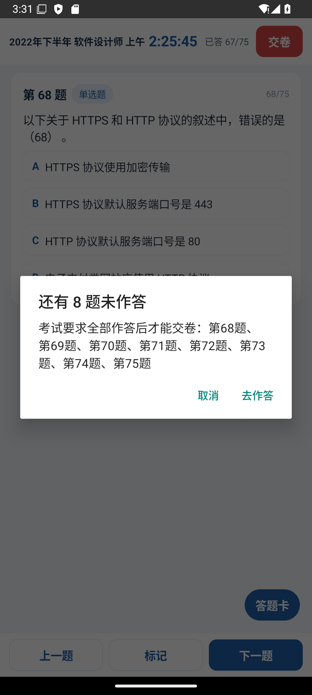
</p>
<p align="center">
  <sub>首页（考试模式 / 练习模式 / 历年真题）　·　真题模考（倒计时 + 答题卡）　·　未答拦截</sub>
</p>

<p align="center">
  
  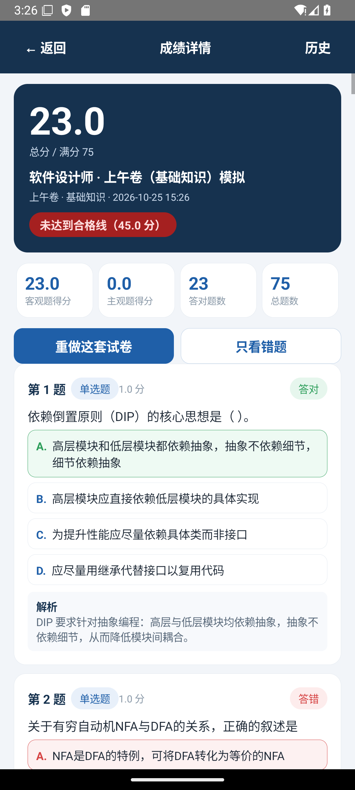
  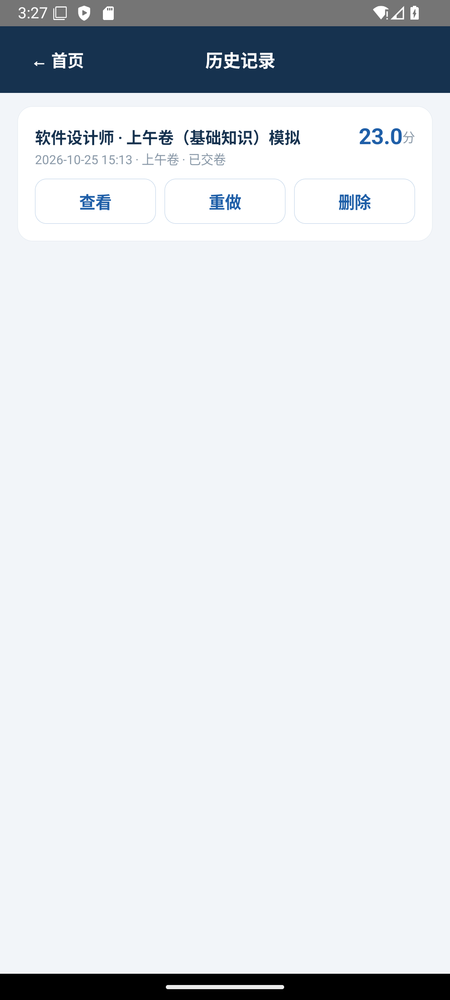
</p>
<p align="center">
  <sub>练习模式（即点即看解析）　·　成绩详情（得分 / 正确率 / 逐题回看）　·　历史记录（查看 / 重做 / 删除）</sub>
</p>

> 以上 App 截图取自 Android 16（API 36）模拟器，分辨率 1080×2400。Web 截图位于 [`tests/screenshots/`](tests/screenshots)。

---

## 题库内容

题库是一份结构化 JSON 数据源（`data/raw/*.json`），经 `npm run validate` 校验后由 `npm run seed` 导入 SQLite，同时作为 Android App 的内置资产打包。

### 规模总览

| 题型 | 代码 | 数量 | 判分方式 |
| --- | --- | ---: | --- |
| 单选题 | `single` | **1051** | 答案匹配，1 分/题 |
| 多选题 | `multi` | **196** | 全部选对才得分（综合卷 2 分/题） |
| 填空题 | `fill` | **352** | 按空给分，支持多个可接受写法 |
| 判断题 | `tf` | **346** | 对/错比对，1 分/题 |
| 主观题（案例题） | `subjective` | **210** | 交卷后对照评分要点自评，15 分/题 |
| **合计** | | **2155** | 覆盖 **1333** 个具体考点 |

### 题型说明

- **单选题（single）**：固定 4 个选项，干扰项按真题风格设计（易混淆概念、计算陷阱），配 80–200 字解析，说明正确理由与错因。
- **多选题（multi）**：4–5 个选项，答案至少 2 项，判分采用「全对得分」，漏选 / 多选不得分。
- **填空题（fill）**：题干中每个空以 `____` 标记，答案逐空比对；同一空支持多种等价写法（如 `O(nlogn)|O(n log n)`），判分前会做全角转半角、去空格、转小写归一化。
- **判断题（tf）**：对一句陈述判断真伪，答案统一归一为「对 / 错」，兼容 `T/F`、`√/×`、`正确/错误` 等写法。
- **主观题（subjective）**：完整案例描述 + 若干小问，附标准答案全文与分点评分要点（rubric），覆盖数据流图、数据库设计、UML 建模、算法设计、C++ / Java 程序设计五类下午卷题型；Web 与 App 均不自动判分，由使用者对照要点自评。

### 知识模块分布

| 模块 | 代码 | 题量 |
| --- | --- | ---: |
| 数据结构与算法 | `DS_ALGO` | 401 |
| 软件工程（含项目管理、软件文档） | `SE` | 369 |
| 面向对象技术（UML、设计模式） | `OO` | 312 |
| 数据库系统 | `DB` | 250 |
| 操作系统 | `OS` | 225 |
| 计算机网络 | `NET` | 175 |
| 程序设计语言与编译原理 | `PL` | 134 |
| 计算机组成与体系结构 | `CO` | 114 |
| 信息安全与法律法规 | `SEC` | 105 |
| 多媒体技术 | `MULTI` | 70 |

难度分布：易 400 / 中 1119 / 难 636（约 19% / 52% / 29%），组卷时按比例分层抽取。

### 历年真题

内置 **2022 年下半年 软件设计师 上午试卷（75 题完整版）**，答案已与官方参考答案逐题核对，可在首页「历年真题」一键整卷模考。

- 来源：GitHub 公开仓库 [chenxuhl/medium-software-designer](https://github.com/chenxuhl/medium-software-designer) 中的《2022年11月软件设计师上午真题及答案解析.pdf》，解析、清洗后导入。
- 其他年份（2021 / 2023 / 2024）的公开真题 PDF 多为扫描图片、缺少可提取答案文本，暂未收录；可用 `scripts/import-real.mjs` 自行导入。

### 题目数据格式

每道题的字段定义与命题质量红线见 [`data/raw/QUESTION_SPEC.md`](data/raw/QUESTION_SPEC.md)，核心字段示例：

```json
{
  "type": "single",
  "topic": "OS",
  "knowledge": "最佳适应算法",
  "difficulty": 2,
  "stem": "最佳适应算法的主要缺点是（ ）。",
  "options": [
    "每次都从低地址开始查找，检索开销大",
    "分配后产生大量难以利用的小碎片",
    "总是优先使用高地址的大分区",
    "回收时无法与相邻空闲分区合并"
  ],
  "answer": ["B"],
  "explanation": "最佳适应算法每次选择能满足要求的“最小”空闲分区，分配后容易留下大量极小碎片，导致外部碎片增多。"
}
```

想补充题目：在 `data/raw/` 下新增或编辑 JSON → `npm run validate -- --strict` 校验 → `npm run seed` 增量导入（幂等，按 `ext_id` 去重）。

---

## 技术架构

```
┌──────────────────────────────┐        ┌───────────────────────────────┐
│  Android App (Kotlin)        │        │  Web 前端（原生 HTML/CSS/JS） │
│  原生 View + SQLite          │        │  无框架、无构建步骤           │
│  内置 assets/questions.db    │        │  响应式：桌面 / 手机          │
└───────────────┬──────────────┘        └───────────────┬───────────────┘
                │ 离线（无网络权限）                     │ HTTP / JSON
                │                                        ▼
                │                       ┌───────────────────────────────┐
                │                       │  Node.js HTTP 服务 server.mjs │
                │                       │  lib/db  ·  lib/paper         │
                │                       │  lib/grade · lib/bank         │
                │                       └───────────────┬───────────────┘
                │                                       ▼
                │                       ┌───────────────────────────────┐
                └──────同一份题库结构────►│  SQLite（node:sqlite）        │
                                        │  data/questions.db            │
                                        └───────────────────────────────┘
```

- **服务端**：Node.js ≥ 22.5，使用内置 `node:sqlite`（`DatabaseSync`），**零运行时依赖**，不需要原生编译。
- **前端**：原生 HTML/CSS/JS，无打包工具；组卷、判分、计时逻辑都在服务端，前端只负责渲染与交互。
- **App**：Kotlin + 原生 View（程序化 UI，无第三方 UI / 网络库）+ SQLite，首次启动把内置题库复制到应用私有目录；`minSdk 24`（Android 7.0+），无网络权限。
- **开发依赖**：`playwright`（浏览器端到端测试）、`pdfjs-dist`（真题 PDF 解析）。

---

## 快速开始

### 环境要求

- Node.js **≥ 22.5**（依赖内置 `node:sqlite`，低版本会报找不到该模块）
- 浏览器（Chrome / Edge / Safari / Firefox 任意现代版本）

### 1. 克隆并导入题库

```bash
git clone https://github.com/ababbaabbhh/softwareexzam.git
cd softwareexzam

npm install          # 仅安装开发依赖（运行时零依赖）
npm run seed         # 校验 data/raw/*.json 并导入 data/questions.db（首次必需，幂等）
```

### 2. 启动服务

```bash
npm start            # 默认 0.0.0.0:8787
# 或自定义端口
PORT=9000 npm start
```

启动后终端会打印：

```
  本机访问   http://127.0.0.1:8787
  局域网访问 http://192.168.x.x:8787
  数据库     data/questions.db
```

手机与电脑连同一 Wi-Fi，用手机浏览器打开「局域网访问」地址即可作答（同一时间只允许一场进行中的考试）。

### 3. 常用命令

| 命令 | 作用 |
| --- | --- |
| `npm start` | 启动 Web 服务（默认 `0.0.0.0:8787`） |
| `npm run seed` | 校验并增量导入题库（幂等） |
| `npm run seed -- --reset` | 清空题目与考试记录后重新导入 |
| `npm run validate` | 校验题库字段与质量规则；加 `--strict` 更严格 |
| `npm test` | 后端自测：评分、组卷、接口全链路 |
| `npm run test:ui` | 浏览器端到端自测（需先启动服务并安装 playwright） |
| `bash start.sh` | 后台常驻启动（已运行时直接返回，日志见 `/tmp/softexam.log`） |

---

## Android App

| 项目 | 说明 |
| --- | --- |
| 语言 / UI | Kotlin + 原生 View（程序化构建，无第三方 UI、网络、数据库库） |
| 兼容性 | `minSdk 24`（Android 7.0+）、`targetSdk 34`、`compileSdk 34` |
| 体积 | 约 1.3 MB，内置题库，**无网络权限，纯离线** |
| 题库 | 打包在 `android/app/src/main/assets/questions.db` |

### 获取 APK

APK 属于构建产物，未纳入 Git 版本库。请到仓库的 **Releases** 页面下载；如无现成安装包，可按下方步骤自行构建。

### 从源码构建

前置：JDK 17、Android SDK（Platform 34 + Build-Tools）、Gradle 8.7+。

```bash
cd android
./build.sh assembleRelease      # 脚本内临时设置 JAVA_HOME / ANDROID_HOME / PATH
# 或使用本机已配置好的环境
gradle assembleRelease
```

> `build.sh` 中的 `JAVA_HOME` / `ANDROID_HOME` 是本项目开发机的路径，请按自己的环境修改，或直接使用已配置好的 `gradle`。

产物：`android/app/build/outputs/apk/release/app-release.apk`。

### 签名配置

`android/app/build.gradle.kts` 中的 `signingConfigs.release` 指向 `android/android.keystore`。签名文件不入库，克隆后请自行生成并配置：

```bash
# 1. 生成自己的 keystore
keytool -genkeypair -v -keystore android/android.keystore \
  -alias softexam -keyalg RSA -keysize 2048 -validity 10000

# 2. 把 android/app/build.gradle.kts 中的 storeFile / storePassword / keyAlias / keyPassword
#    换成上一步的值；更推荐改为从 local.properties 或环境变量读取，避免密码进入版本库。
```

`android.keystore`、`*.jks`、`local.properties` 均已加入 `.gitignore`。

### 同步题库到 App

App 使用随包打包的 SQLite 资产，而不是 `data/questions.db`。修改题库后重新导入并同步：

```bash
npm run seed
cp data/questions.db android/app/src/main/assets/questions.db
```

---

## 项目结构

```
software_test/
├── server.mjs                 # HTTP 服务、静态资源与全部 API 路由
├── lib/
│   ├── db.mjs                 # SQLite 访问层（node:sqlite）、表结构与考试/作答读写
│   ├── paper.mjs              # 组卷策略（四种模式、权重分层抽样、真题整卷）
│   ├── grade.mjs              # 判分规则（单选/多选/判断/填空 + 合格线）
│   └── bank.mjs               # 题库读取、校验、去重与统计
├── public/                    # Web 前端（原生 HTML/CSS/JS，无构建）
│   ├── index.html
│   ├── app.js
│   └── style.css
├── data/
│   ├── raw/                   # 题库源文件：按模块拆分的 JSON + QUESTION_SPEC.md
│   └── questions.db           # 由 npm run seed 生成（不入库）
├── scripts/
│   ├── seed.mjs               # 导入 SQLite（幂等，支持 --reset）
│   ├── validate.mjs           # 题库校验与统计
│   ├── import-real.mjs        # 导入历年真题（PDF → 题库）
│   └── real/parse.mjs         # 真题 PDF 解析器
├── tests/
│   ├── selftest.mjs           # 后端自测（评分 / 组卷 / 接口全链路）
│   ├── ui-test.mjs            # Playwright 浏览器端到端自测
│   ├── screenshots/           # Web 端截图
│   ├── 自测报告.md
│   └── APP自测报告.md
├── android/                   # Android App（Kotlin + 原生 View + SQLite）
│   ├── app/src/main/java/com/softexam/     # 首页 / 考试 / 练习 / 成绩 / 历史 + core / data / ui
│   ├── app/src/main/assets/questions.db    # 内置题库（随包分发）
│   ├── app/src/test/                       # JVM 单元测试（评分 / 组卷 / 冒烟）
│   ├── build.sh                            # 构建脚本（临时导出工具链环境变量）
│   └── build.gradle.kts
├── docs/
│   ├── 开发文档.md             # 需求、架构、数据库、组卷与评分设计
│   ├── APP开发文档.md          # App 页面、数据层与构建说明
│   └── screenshots/app/        # App 截图
├── start.sh                    # 后台常驻启动脚本
├── package.json
└── .gitignore
```

---

## HTTP API

所有接口返回 JSON；错误统一为 `{ "error": "..." }`，交卷时存在未答题返回 `422` 并附带 `unanswered` 题号数组。

| 方法 | 路径 | 说明 |
| --- | --- | --- |
| GET | `/api/health` | 健康检查 |
| GET | `/api/meta` | 题库统计、可用真题套、考试模式、进行中的考试、局域网地址 |
| GET | `/api/papers` | 可用真题套列表 |
| POST | `/api/exams` | 创建考试 `{ mode, paper? }`（`morning` / `afternoon` / `mixed` / `real`） |
| GET | `/api/exams` | 历史考试列表 |
| GET | `/api/exams/:id` | 试卷详情、剩余秒数、作答进度（交卷后才返回答案与解析） |
| PATCH | `/api/exams/:id/answers` | 保存单题作答 `{ seq, answer }` |
| POST | `/api/exams/:id/submit` | 交卷（存在未答题返回 422） |
| POST | `/api/exams/:id/abort` | 放弃考试 |
| GET | `/api/exams/:id/result` | 成绩详情与逐题解析 |
| POST | `/api/exams/:id/grade-subjective` | 主观题自评 `{ scores: [{ seq, score }] }` |
| POST | `/api/exams/:id/retake` | 按原题、原顺序重做 |
| DELETE | `/api/exams/:id` | 删除考试记录 |
| GET | `/api/practice/next` | 练习模式取下一题（`?mode=basic\|application&pos=N`，整库洗牌循环，一轮内不重复） |
| POST | `/api/practice/check` | 练习判分与解析 `{ qid, answer }` |

---

## 数据库结构

单个 SQLite 文件（默认 `data/questions.db`）同时承载题库与考试记录，复制该文件即可备份 / 迁移。

| 表 | 用途 | 关键字段 |
| --- | --- | --- |
| `questions` | 题库 | `id`、`ext_id`（去重）、`type`、`topic`、`knowledge`、`difficulty`、`stem`、`options`、`answer`、`rubric`、`explanation`、`score`、`paper` / `paper_title` / `seq_no`（真题） |
| `exams` | 考试场次 | `mode`、`title`、`duration_sec`、`started_at`、`deadline_at`、`status`、`auto_submitted`、`objective_score`、`subjective_score`、`total_score`、`max_score` |
| `exam_questions` | 试卷题目与作答 | `exam_id`、`seq`、`qid`、`section`、`score`、`user_answer`、`is_correct`、`awarded`、`graded` |
| `settings` | 运行时状态 | `k`、`v`（练习轮次顺序等） |

`options` / `answer` / `rubric` 以 JSON 文本存储，读取时反序列化。

---

## 测试

```bash
npm test                     # 后端：判分（单选/多选/填空/判断）、组卷配额、接口全链路
npm run test:ui              # 浏览器：首页、考试、答题卡、未答拦截、交卷、成绩、历史、移动端布局
cd android && gradle test    # App：评分 / 组卷 / 数据库冒烟（Robolectric）
```

历史自测结果见 [`tests/自测报告.md`](tests/自测报告.md) 与 [`tests/APP自测报告.md`](tests/APP自测报告.md)。

---

## 参与贡献

欢迎补充题目、修复缺陷或改进 UI：

1. 新增题目请先阅读 [`data/raw/QUESTION_SPEC.md`](data/raw/QUESTION_SPEC.md)（字段规范、模块代码、命题质量红线）。
2. 提交前跑一遍 `npm run validate -- --strict` 与 `npm test`。
3. 一个 PR 尽量只做一件事（补题 / 修 bug / 改界面），并在描述里说明动机与影响范围。
4. 题库类 PR 请在描述中给出新增题目数量与所属模块。

Issue / PR 中文或英文皆可。

---

## 常见问题

**Q：必须联网吗？**
不需要。Web 端只在本机 / 局域网内提供 HTTP 服务；App 完全不联网（`AndroidManifest.xml` 未声明网络权限）。

**Q：可以多人同时用吗？**
目前的定位是**单用户本地工具**：同一时间只允许一场进行中的考试，也没有账号体系。若要多端使用，请各自部署一份。

**Q：手机打开局域网地址打不开？**
确认手机与电脑在同一 Wi-Fi、电脑防火墙放行 8787 端口、服务监听在 `0.0.0.0`（默认即是）。

**Q：题库答案一定正确吗？**
题目为按考纲与真题风格编写的模拟题，答案与解析经过规则校验；主观题由使用者对照要点自评。正式备考请以官方教材与真题为准。

**Q：`npm start` 报找不到 `node:sqlite`？**
Node.js 版本低于 22.5，请升级（`node -v` 确认）。

**Q：如何清空数据 / 重新开始？**
删除 `data/questions.db` 后执行 `npm run seed` 即可重建题库并清空历史；App 端在系统设置里清除应用数据。

---

## 免责声明

- 本项目仅用于个人学习与备考练习，**不得用于任何商业用途**。
- 题库中的模拟题为原创或改编，历年真题版权归原权利人所有，本项目仅作学习交流之引用；如权利人认为不妥，请联系删除。
- 模拟考试成绩不代表真实考试结果，正式考试以官方教材、大纲与真题为准。

---

## 许可证

本项目**尚未选择开源许可证**（未附带 `LICENSE` 文件时默认保留所有权利）。

如果希望他人可以自由使用、修改与分发，建议在发布正式版本前添加一份许可证，例如：

- [MIT](https://choosealicense.com/licenses/mit/)：最简单宽松，适合工具类项目；
- [Apache-2.0](https://choosealicense.com/licenses/apache-2.0/)：额外包含专利授权与商标条款，适合后续可能商用 / 企业使用的项目。

选定后把 `LICENSE` 文件放到仓库根目录，并替换本节说明即可。

---

## 致谢

- 真题来源：[chenxuhl/medium-software-designer](https://github.com/chenxuhl/medium-software-designer)（2022 年下半年上午卷）
- 软考大纲与题型参考：全国计算机技术与软件专业技术资格（水平）考试「软件设计师」考试大纲
- 项目内使用的工具：Node.js 内置 `node:sqlite`、Playwright、pdf.js
